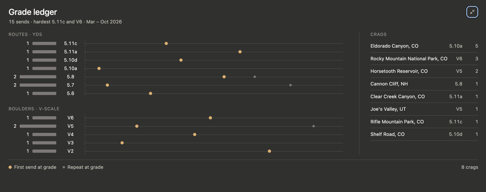

# Climbing Log

An [MCP App](https://github.com/modelcontextprotocol/ext-apps) that shows a climbing log inside Claude. The MCP server exposes one tool, `get-sends`, which returns the climbs (sends) in `sends.json`, along with a React view that the host renders in the conversation as a **grade ledger**: one row per grade, hardest first, with a count bar and a timeline of sends. The first send at each grade is highlighted. You can switch between routes (YDS) and boulders (V-scale), hover or tap a send for details, and open a fullscreen view with both disciplines and a per-crag summary. It follows the host's light or dark theme.



## Requirements

- Node.js 22 or later
- npm

```bash
npm install
```

## Run it against basic-host

[basic-host](https://github.com/modelcontextprotocol/ext-apps/tree/main/examples/basic-host) is the reference MCP Apps host from the ext-apps repository. It's handy for testing without Claude.

1. Start the server and the view in watch mode. The MCP server listens on `http://localhost:3001/mcp`:

   ```bash
   npm start
   ```

2. In a separate checkout of [ext-apps](https://github.com/modelcontextprotocol/ext-apps), start basic-host. It connects to `localhost:3001` by default, and its server runs on [Bun](https://bun.sh):

   ```bash
   cd examples/basic-host
   npm install
   npm run start
   ```

3. Open http://localhost:8080, pick the **Climbing Log** server and the `get-sends` tool, and click **Call Tool**.

## Connect it to Claude Desktop

Claude Desktop starts the server itself and talks to it over stdio.

1. Build the view once (and again after you change it):

   ```bash
   npm run build
   ```

2. Add the server to `~/Library/Application Support/Claude/claude_desktop_config.json` (macOS). Replace `/path/to/climbing-log` with the absolute path to this repository:

   ```json
   {
     "mcpServers": {
       "climbinglog": {
         "command": "/path/to/climbing-log/node_modules/.bin/tsx",
         "args": ["/path/to/climbing-log/main.ts", "--stdio"]
       }
     }
   }
   ```

3. Fully quit and reopen Claude, then ask something like "Show me my sends."

If the server doesn't connect, Claude writes its output to `~/Library/Logs/Claude/mcp-server-climbinglog.log`.

## Tests

The grade, timeline, tooltip-placement and crag logic is covered by unit tests using Node's built-in test runner:

```bash
npm test
```

## Known limits

- **US grade formats only:** YDS for routes (`5.6`–`5.15d`) and the V-scale for boulders (`VB`–`V17`). Modifiers and slash grades (`5.10+`, `5.10a/b`, `V3-4`) and other scales (French, Font) aren't supported; sends with those grades are left out of the ledger.
- **No validation of `sends.json`:** the server reads the file as-is. A missing file or malformed JSON makes the tool call fail with a raw error.

## Credits

Built with the [`@modelcontextprotocol/ext-apps`](https://github.com/modelcontextprotocol/ext-apps) SDK. The server, view hooks and theming come from it, and the project started from its quickstart.

## License

[MIT](LICENSE)
